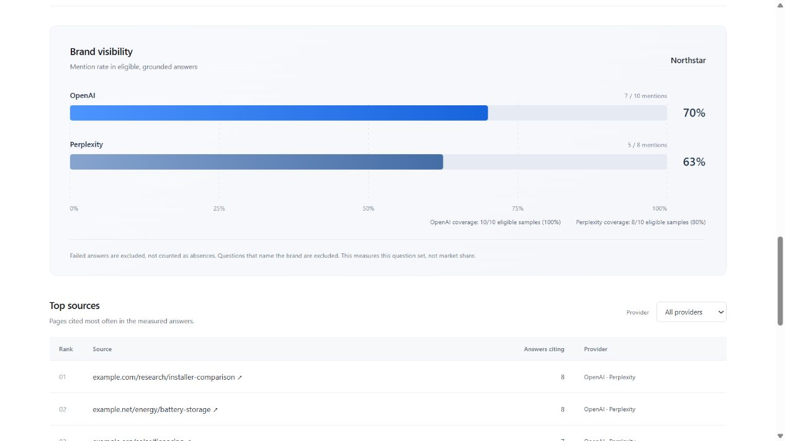

# Visibility Lab

A small, local workbench for measuring whether a brand appears in search-grounded AI answers. Choose questions, bring your own API keys, and compare mention rates alongside coverage and linked sources.

The interface is a single page. It includes a provider comparison chart, a source table, inspectable answers and a JSON export. The initial example is fictional and makes no API calls.



*Illustrative example with a fictional brand, answers and source links. These are not measured provider results.*

## Run locally

Install [Node.js 22 or later](https://nodejs.org/en/download), download this repository, and open a terminal in its folder:

```sh
npm start
```

Open the local address printed in the terminal: `http://127.0.0.1:4173`. No dependency installation, database, account or build step is needed. Keep the terminal open while using the app. Stop it with Ctrl+C.

If that port is already occupied, choose another:

```powershell
# PowerShell
$env:PORT = '4187'
npm start
```

```sh
# macOS / Linux
PORT=4187 npm start
```

Use the printed `127.0.0.1` address rather than `localhost`; the server checks its Host and Origin. Opening the HTML file directly will not work. A local address is accessible only on the computer running the app. Share the repository link so another person can run their own copy.

## An analysis

1. Enter a brand and any exact aliases you want counted.
2. Enter a category and market. Choose 1–30 questions and click **Build questions**, or write one question per line. Question generation uses editable templates, not an API call. Write questions in the language you want to research.
3. Select OpenAI, Perplexity, or both. Enter an API key for each selected provider. OpenAI uses Responses with required web search; Perplexity uses Agent API with its `fast` search preset.
4. Check the maximum API attempt count. Optionally enable cross-provider fallback under **Run settings**, then run.
5. Inspect the chart, source links and individual answers. Export results before closing the page if you want to keep them.

Keys are cleared from the input fields once a request is submitted. There is no key persistence or server log of request content. Keys necessarily exist in browser/server memory during submission and execution; this is not protection against a compromised computer. Prompts and responses are processed under the selected provider's policies. Billable work may continue upstream after cancellation or a timeout.

## Reading the results

**Visibility** is the percentage of eligible, completed primary answers that mention the brand or an alias. Matching is case-insensitive with Unicode word boundaries; it does not infer entities or sentiment. URLs and citation markers are not mentions. Questions naming the brand, including in a URL, are excluded to reduce prompting bias.

**Coverage** is eligible primary answers divided by eligible planned requests. A failed or uncited answer is missing data, not a negative result. No eligible answers produces an empty score, not zero. Partial coverage can bias the comparison.

**Top sources** lists up to 25 cited page URLs, ranked by number of eligible primary answers citing each page. A page counts at most once per answer. Fallback answers remain inspectable but do not enter the comparison or source ranking. Retrieved but uncited sources are not counted.

Citation checks establish that provider metadata resolves to acceptable web URLs and valid answer spans or source IDs. They do **not** establish factual accuracy, claim support or current page availability. The app never fetches arbitrary source URLs on your behalf.

## Validation status

```sh
npm test
npm run check
```

The test suite uses synthetic responses and loopback HTTP only. It covers evidence parsing, mention boundaries, missing-data semantics, retries, cancellation, fallback attribution, concurrency, credential redaction, local request protection and response-size limits. **No real API keys or live provider requests were used to validate this release.** A live run may expose account, model, schema or rate-limit differences that fixtures cannot reproduce.

The provider contracts were reviewed against official documentation on 7 October 2026. `gpt-4.1-mini` is the default OpenAI model and can be changed in the UI. Perplexity's preset may change its underlying model; the returned model is retained with each answer. API results are not a measurement of the consumer ChatGPT or Perplexity interfaces.

## Project notes

- [Architecture](ARCHITECTURE.md)
- [Design decisions](DESIGN_DECISIONS.md)
- [Known limitations](KNOWN_LIMITATIONS.md)
- [Provider contracts and references](docs/PROVIDERS.md)
- [Development and review notes](docs/DEVELOPMENT.md)
- [Process case study](docs/PROCESS_CASE_STUDY.md)

This is an independent portfolio prototype, developed with AI assistance and explicit review of failure handling and measurement assumptions. It contains no production customer data, proprietary prompts or private platform implementation. It is not affiliated with the API providers.
